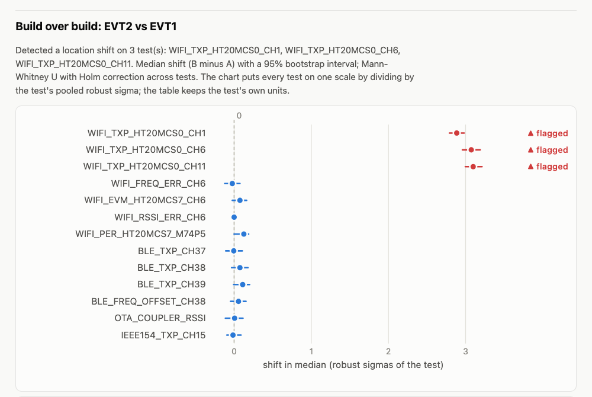

# RadioYield: wireless test data and yield analysis

RadioYield is a toolkit for the path from a radio test to a production decision. It has four parts:

- **Firmware** that runs Wi-Fi, Bluetooth LE and 802.15.4 tests between two ESP32-C6 boards and logs every packet.
- **A C++ reader and writer** for STDF V4, the test industry's standard data format.
- **An analysis engine** for what a factory line asks of that data: yield, Cpk, failure Pareto, build-over-build comparison, station correlation, drift, and outlier-unit screening. Every detector is scored against known answers.
- **UWB work on public measurement data:** LOS/NLOS classification and ranging-error correction.

Languages follow the job: C on the device, C++ for the data path, Python for analysis.



*Above: part of a generated report on a **simulated** lot. Build EVT2 was injected with +0.8 dB on the three Wi-Fi TX power tests. The comparison flags exactly those three, and nothing else.*

## What is real and what isn't

Read this before reading any number. The rule, carried over from [Dyno](https://github.com/Sanjith-Shan/dyno), is that an unmeasured number is not a number.

| Part | Status | Label in data and reports |
|---|---|---|
| STDF reader/writer, benchmark, fuzzing | **Measured** on this machine | n/a: a software fact |
| Analysis engine | **Scored on simulated lots** with injected faults | `SIMULATED`, printed on every report and stored in every row's `data_origin` |
| UWB LOS/NLOS and ranging | **Real public data** recorded by other labs on DW1000 radios | `PUBLIC_DATASET`; not our hardware |
| ESP32-C6 firmware + collector | Written and host-tested. **Not yet compiled against real ESP-IDF** (CI does that), **not yet run on boards** | `RIG_OTA` / `RIG_CONDUCTED` once measured |
| Rig session rehearsal | The whole M2 runbook **run in simulation** through the real collector and fits, against a hallway model with known truth | `SIMULATED`; [docs/results/sim_rig.md](docs/results/sim_rig.md) |
| Rig numbers: path loss, TX linearity, PER waterfall | **Not yet measured** (milestone M2) | [docs/results/rig.md](docs/results/rig.md) |

**What this cannot measure, ever, with two ESP32s:**
- EVM, spectral mask, ACLR and absolute TX power. These need an RF tester.
- TRP and TIS. These need an anechoic chamber.
- Calibrated received power. ESP32 RSSI is an uncalibrated integer-dBm estimate, and the datasheet states no accuracy for it.

**Out of scope:** NFC, cellular, and any LLM feature.

## Headline numbers

Full table, with the command behind each number: [docs/RESULTS.md](docs/RESULTS.md). Baselines: [docs/BASELINES.md](docs/BASELINES.md).

- **STDF read: 34.3× faster than pystdf** (95% CI 33.8–35.5) and 257× faster than Semi-ATE STDF, on the largest real public STDF file (11.7 MB, 162,655 records). It is 40.7× faster than pystdf on a 65.6 MB file (184 MB/s).
- **STDF fuzzing:** a 30-minute libFuzzer + ASan + UBSan campaign ran 2.09M executions with 0 crashes. 2 bugs found outside the campaign were fixed, each with a regression test.
- **Detectors, SIMULATED, 50 lots per scenario:**
  - Station +1.5 dB offset, 0.1 dB/h station drift, +0.8 dB build shift and a bimodal antenna lot: each detected **50/50**.
  - PAT catches 98.4% of injected marginal units.
  - Drift and PAT false alarms on clean lots: **0/50**.
  - Drift is caught a median of 1.9 h after onset.
- **UWB LOS/NLOS, public eWINE data:**
  - 92.6% on a held-out acquisition-config split. True leave-one-site-out is impossible because the release has no site labels.
  - 93.1% on a random split, against 87.4–90.0% published.
- **UWB ranging, public IDLab data, held-out session:** MAE falls from 0.196 to 0.144 m and p95 from 0.584 to 0.472 m.
- **Virtual rig, SIMULATED, 30 sessions:** rehearsing the M2 session against a simulated hallway found four defects in the plans before any hardware time was spent:
  - The over-the-air PER waterfall is unreachable in a hallway: the link is about 40 dB short at the lowest TX power.
  - The 80 dB conducted chain never reaches the Wi-Fi waterfall.
  - With 5 repeats, Holm correction makes a deliberate −2 dB build change undetectable (3/30 sessions).
  - Five path-loss positions leave the exponent CI 2.8 wide.

  With the revised plans, the −2 dB change is flagged in 30/30 sessions and a null change in 0/30.

## Architecture

```
  ESP32-C6 DUT ──radio──> ESP32-C6 REF                  firmware/   (C, ESP-IDF v5.5.6)
        │ USB serial           │ USB serial
        └──────────┬───────────┘
          radioyield/collector/   YAML sweep plans -> STDF V4 + per-packet Parquet
                   │
          stdf/  (C++17, pybind11) STDF V4 reader + writer -> Arrow tables
                   │
          radioyield/analysis/    yield, Cpk, Pareto, build compare, station correlation,
                   │              gauge R&R, drift (CUSUM/EWMA), dynamic PAT, RF fits
                   │
          radioyield/report/      one self-contained HTML file per lot

  radioyield/uwb/   public DW1000 data -> LOS/NLOS classifier + ranging-error model
  radioyield/sim/   synthetic lots with injected faults; known-answer scoring only
```

Every component meets at one table schema, [`radioyield/schema.py`](radioyield/schema.py): one row per (part, test) result. The STDF reader produces it; the simulator, the collector and the STDF writer consume or emit it; every analysis function takes it. Setup facts travel inside the STDF file as `ry.<key>=<value>` DTR records. These include distance, OTA vs conducted, attenuators and `data_origin`.

## Quick start

```bash
make venv          # uv venv + editable install with dev, bench and rig extras
make test          # builds the C++ extension and the codec host tests, then runs everything hardware-free

radioyield sim --scenario build_shift --seed 7 --out out/lot.parquet --stdf out/stdf/
radioyield report out/stdf/ --out out/report.html          # analyse STDF files directly
radioyield demo --out examples/                            # one report per simulated scenario
make score                                                 # known-answer scoring, about 1 min

python -m radioyield.uwb fetch && make uwb                 # public UWB data (~318 MB) and results
```

Rig session (M2). The step-by-step runbook is [docs/RIG.md](docs/RIG.md).

```bash
python -m radioyield.collector ports                       # find DUT and REF
python -m radioyield.collector run plans/smoke_wifi_1m.yaml --dut /dev/cu.usbmodemA --ref /dev/cu.usbmodemB --out out/rig/
radioyield report --rig out/rig/ --out out/rig_report.html # lot analysis + PER waterfall, path loss, TX linearity
```

No boards? `--fake` runs the whole collector against a serial test double. Its output is always labelled `SIMULATED`.

The whole session can be rehearsed with no boards: `python -m radioyield.sim.rig session --seed 7 --out out/sim_rig/seed7`, then `radioyield report --rig out/sim_rig/seed7 --out out/sim_rig.html`. `make rig-sim` scores 30 rehearsals against their known truth.

## Design notes worth reading

- **Refusals are features.**
  - Cpk is refused, with the reason printed, on fewer than 30 parts, on quantized data, on bimodal data and on clearly non-normal data.
  - PAT and drift charts skip skewed or quantized tests instead of flagging their tails.
  - The PER waterfall refuses to fit data that never reached the waterfall.
- **False alarms are measured, not assumed.** The textbook CUSUM (h = 5) alarmed on every clean simulated lot. The decision interval is calibrated on separate seeds and then scored on held-out ones. The full story is in [docs/results/sim.md](docs/results/sim.md).
- **The station-correlation reference is a consensus** (the median across stations), so a bad "reference station" cannot hide.
- **Bimodal tests are attributed.** The report says whether one station or build makes up the second mode.

## Repository map

| Path | What |
|---|---|
| `firmware/` | ESP-IDF project (DUT/REF roles, Wi-Fi ESP-NOW, BLE, 802.15.4), portable codec with host tests, [PROTOCOL.md](firmware/PROTOCOL.md) |
| `stdf/` | C++17 STDF V4 reader/writer, pybind11 module, fuzz harness, benchmark, [README](stdf/README.md) |
| `radioyield/collector/` | Sweep runner, serial transport, test double, [README](radioyield/collector/README.md) |
| `radioyield/analysis/` | The production analysis engine |
| `radioyield/sim/` | Synthetic lots, the virtual rig, and known-answer scoring |
| `radioyield/report/` | HTML report |
| `radioyield/uwb/` | UWB public-data work |
| `plans/` | Example YAML sweep plans |
| `examples/` | Generated example reports (simulated) |
| `docs/` | [RESULTS](docs/RESULTS.md), [BASELINES](docs/BASELINES.md), [INTERVIEW](docs/INTERVIEW.md), [RIG](docs/RIG.md) |

## License

MIT
